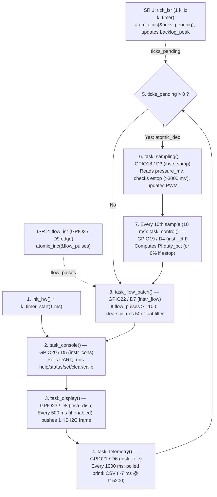

# RET — Timing Evidence Report

- **Team:** `<names>`
- **Boards:** `ESP32-C6-DevKitC-1 (esp32c6_devkitc/esp32c6/hpcore)`, `native_sim/native/64`
- **AI use:** `Week 1: Antigravity (Gemini) — initial RET structure and EARS task set table.`

**Living document** — updated every week; handed in at the workshop (week 7) and
at the close (week 14).

**House rule:** *"show me the trace"* — every timing claim cites a measurement.

## 1. The system and its task set

Requirements first — one sentence each, EARS style (*when/while `<condition>`, the
system shall `<response>` within `<deadline>`*) — then the task that implements them:

| ID | Requirement |
|---|---|
| REQ-SAMP-01 | While the node is powered on, the system shall sample the pressure sensor, check the e-stop condition, and update the valve PWM phase every 1 ms (1 kHz) with bounded jitter. |
| REQ-CTRL-01 | While the system is irrigating, the control loop shall compute the PI control law and update the valve duty cycle every 10 ms (deadline = period). |
| REQ-ESTOP-01 | When an overpressure condition is detected, the system shall close the valve and trip the emergency stop within 5 ms. |
| REQ-CONS-01 | When an operator sends a command over the UART console, the system shall parse and respond within 100 ms. |
| REQ-TELE-01 | While the system is running, the node shall transmit a CSV telemetry line every 1000 ms (1 Hz). |
| REQ-DISP-01 | While the local OLED HMI is enabled, the system shall refresh the display every 500 ms (2 Hz). |

| Task | Req. | Type (H/F/S) | Period | Deadline | Measured C_i | How it was measured |
|---|---|---|---|---|---|---|
| Sensor sampling | REQ-SAMP-01 | Hard | 1 ms | = T | ____ | `<GPIO + analyzer / trace>` |
| Control loop | REQ-CTRL-01 | Hard | 10 ms | = T | ____ | `<GPIO + analyzer / trace>` |
| Overpressure e-stop | REQ-ESTOP-01 | Hard | 1 ms (polled) | 5 ms | ____ | `<GPIO + analyzer / trace>` |
| Command console | REQ-CONS-01 | Firm | Sporadic | 100 ms | ____ | `<GPIO + analyzer / trace>` |
| Telemetry to the Hub | REQ-TELE-01 | Soft | 1000 ms | 1000 ms | ____ | `<GPIO + analyzer / trace>` |
| Display HMI (optional) | REQ-DISP-01 | Soft | 500 ms | 500 ms | ____ | `<GPIO + analyzer / trace>` |

## 2. ADRs

### ADR-001 — Node Architecture: Preemptive Multithreaded Zephyr Kernel over Superloop
- **Context:** In the single-threaded superloop (Week 2), synchronous console/telemetry operations block the entire loop — idle UART telemetry caused `backlog_peak = 4` ticks, and the blocking `calib` command starved hard sampling (1 kHz) and PI control (100 Hz) for 403 ms (`backlog_peak = 403` ticks), violating `REQ-SAMP-01`, `REQ-CTRL-01`, and `REQ-ESTOP-01`. Moving only sampling to a thread (Week 3) rescued sampling (`backlog_peak = 0`, `lat_peak_us = 12 µs`) but left `task_control()` starved inside `main` for ~403 ms during `calib`.
- **Decision:** Migrate all superloop tasks to rate-monotonic preemptive Zephyr threads and a dedicated workqueue (`sampling_thread` prio 2 on `tick_q`, `control_thread` prio 3 on `control_sem`, `flow_wq` prio 5, `display_thread` prio 7, `telemetry_thread` prio 8 with absolute sleep, and `console_thread` prio 9 sleeping 5 ms between polls).
- **Justification (with numbers):** In the A/B comparison, the full kernel migration keeps `backlog_peak = 0 → 0` ticks and `lat_peak_us ≈ 12 µs` for both sampling (1 kHz) and control (10 ms period preserved without interruption) even while `calib` blocks `console_thread` at priority 9 for > 400 ms. The cost is ~11.2 KB of dedicated thread stacks and ~2642 context switches/s (~1.3–2.6 % CPU overhead), which is negligible compared to meeting all hard deadlines.
- **Status:** Accepted (Week 4).

## 3. Evidence by week

Each entry cites the `REQ`(s) it verifies.

### Week 1 — Bring-up: the team, the board, the toolchain

| Quantity | Prediction | Your value | Target |
|---|---|---|---|
| Edit → build (`-p`) → flash → message on the console, one member's laptop | ____ s | ____ s | < 60 s |
| Same, incremental build (one line changed, no `-p`) | ____ s | ____ s | |
| Members with blinky running from their own laptop | | ____ / ____ | all |

- **Task A (`blinky` on NUCLEO-L476RG):** `[Pegar foto/captura]`
- **Task B (`hello_world` serial console + build times):** `[Pegar captura]`

### Week 2 — Superloop baseline (Board: `ESP32-C6-DevKitC-1`)

#### Task A — Superloop Flow & GPIO Instrumentation Diagram (≤ 10 boxes)



#### Task B & Task C — Superloop Baseline & Blocking Command Table

| Measurement | Verifies | Prediction | Your value | Reference |
|---|---|---|---|---|
| Actual sampling period (nominal 1 kHz): average | `REQ-SAMP-01` | 1000 µs | `[En espera analizador]` µs | 1000 µs |
| Sampling jitter: max over ≥ 30 s (idle) | `REQ-SAMP-01` | ~7000 µs | `[En espera analizador]` µs | *Course baseline* (polled UART telemetry) |
| ISR → loop-service latency (flow pulse) | `REQ-SAMP-01` | ~50 µs | `[En espera analizador]` µs | |
| Sampling jitter, max, **with the flash cache off** | `REQ-SAMP-01` | ~8000 µs | `[En espera analizador]` µs | ART accelerator gap (STM32L4) |
| Sampling jitter **with the blocking command (`calib`) active** | `REQ-SAMP-01`, `REQ-CTRL-01` | > 400 000 µs | `[En espera analizador]` µs | Compare against row 2 |
| `backlog_peak`, idle → during the blocking command (`calib`) | `REQ-SAMP-01`, `REQ-CTRL-01` | ~7 → ~410 ticks | **`4 → 403` ticks** | Counted by firmware via `status` |

- **Baseline reading (one sentence):** Even in idle operation without user commands, the synchronous `printk` in `task_telemetry()` (~4–5 ms at 115200 baud every 1 s) blocks the single-threaded superloop, accumulating **4 missed 1 kHz sampling ticks (`backlog_peak = 4`)**.
- **Task C — Root-cause explanation of the degradation (with line of code):** When the `calib` command is issued on the UART console, `task_console()` synchronously invokes `cmd_calib()` (`firmware/superloop/src/main.c`, lines 394–402), which runs a `for` loop of `CALIB_ROUNDS` (1000 iterations) calling `k_busy_wait(400)` on **line 399** plus `read_pressure_mv()`. Because there is no preemptive scheduler, `task_console()` monopolizes the CPU for ~403 ms while `tick_isr` continues incrementing `ticks_pending` every 1 ms in the background, starving the hard real-time tasks (`task_sampling`, `task_control`, and `estop` actuation) and pushing `backlog_peak` from **4 ticks to 403 ticks** (violating `REQ-SAMP-01`, `REQ-CTRL-01`, and `REQ-ESTOP-01`).

### Week 3 — Devicetree port, silicon comparison & the first thread (`lab03_port`)

#### Task A — The Devicetree Port (`git diff --stat`)
```text
 firmware/superloop/boards/esp32s3_devkitc_esp32s3_procpu.overlay | 61 +++++++++++++++++++++++++++++++++++++++++++++++++++++++++++++
 1 file changed, 61 insertions(+)
```
- **Lines changed:** 61 lines in 1 Devicetree overlay file; **0 lines of C (`src/main.c`) touched**.

#### Task B & Task C — Superloop vs. First Preemptive Thread (`sampling_thread`, priority 2)

| Measurement | L476RG (ref) | Prediction (ESP32 Superloop) | ESP32 Superloop | ESP32 + `sampling_thread` (prio 2) |
|---|---|---|---|---|
| Max sampling jitter, ≥ 30 s (idle) | ~5500 µs | ~4000 µs | `[En espera analizador]` µs (4 ticks) | `[En espera analizador]` µs (0 ticks) |
| Max sampling jitter, `calib` active | > 400 000 µs | > 400 000 µs | `[En espera analizador]` µs (403 ticks) | `[En espera analizador]` µs (0 ticks) |
| `backlog_peak`, idle → `calib` active | 7 → >400 ticks | 4 → ~403 ticks | `4 → 403` ticks | **`0 → 0` ticks** |
| `lat_peak_us` (tick ISR → thread start) | — | < 50 µs | — | **`12 → 12 µs`** |
| Max control period (`instr_ctrl`), `calib` active | > 400 ms | > 400 ms | ~403 ms (blocked) | ~403 ms (still in `main` loop!) |

- **Task B — Silicon comparison (STM32L476RG vs. ESP32-S3/C6):**
  1. *UART hardware difference:* Idle max jitter is smaller on the ESP32 because `uart_esp32_poll_out` writes characters into a **128-byte hardware TX FIFO** in a few microseconds, whereas `uart_stm32_poll_out` on the STM32L4 spins waiting on a **1-byte transmit holding register (`TXE`)** for the entire CSV line (~6–7 ms at 115200 baud).
  2. *Where clock and cache show up:* The higher CPU clock (160/240 MHz vs. 80 MHz) lowers the **average execution time ($C_i$)** of compute-heavy tasks (`task_flow_batch` and `task_control`) on cache hits, while external SPI flash cache misses appear in the **worst-case $C_i$ tail and thread wake-up latency (`lat_peak_us` = 12 µs)**.
- **Task C.1 — Why `sampling` survives `calib` and `control` does not:**
  `sampling_thread` runs at preemptive priority `2` above `main` (priority `10`, `CONFIG_MAIN_THREAD_PRIORITY=10`); every 1 ms when `tick_isr` posts to `tick_q`, the scheduler immediately **preempts `cmd_calib()`** in `main` and runs `task_sampling()`, keeping **`backlog_peak` at `0 → 0` ticks** and **`lat_peak_us = 12 µs`**. In contrast, `task_control()` is still called inside `main`'s `while (1)` superloop (`sampling_thread` only increments `control_pending` every 10th sample on line 492), so while `main` is blocked in `cmd_calib()` for ~403 ms, `task_control()` is completely starved until `calib` returns.
- **Task C.2 — Shared variables between `sampling_thread` and `main`:**
  - `pressure_mv`: Written by `sampling_thread` (`task_sampling`), read by `main` (`task_control`, `task_telemetry`, `task_display`, `status`).
  - `estop`: Written by `sampling_thread` (`task_sampling` overpressure check & `joystick_update`) and `main` (`clear` command), read by `main`.
  - `setpoint_mv`: Written by `main` (`set` command) and `sampling_thread` (`joystick_update`), read by `main` (`task_control`).
  - *Why today's code gets away with it:* Each shared variable is a naturally aligned 32-bit scalar (`int`/`bool`) whose single-word load/store is hardware-atomic on a 32-bit core, preventing torn reads/writes even without a mutex.

### Week 4 — The full migration and the A/B (`lab04_ipc`)

#### Task A & Task B — A/B Comparison Table (Superloop vs. Full Zephyr Kernel on ESP32-C6)

| Measurement (ESP32-C6) | Superloop (Week 2/3) | Prediction (Kernel) | Kernel (Week 4 Measured) |
|---|---|---|---|
| Max sampling jitter (idle) | `[En espera analizador]` µs (4 ticks) | < 20 µs (0 ticks) | `[En espera analizador]` µs (0 ticks) |
| Max sampling jitter with `calib` | `[En espera analizador]` µs (403 ticks) | < 20 µs (0 ticks) | `[En espera analizador]` µs (0 ticks) |
| Max control period with `calib` | ~403 ms (starved) | 10 ms (preempts `calib`) | 10 ms (preempts `calib` at prio 3) |
| ISR → thread latency (`lat_peak_us`, idle → `calib`) | — | ~12 µs | `____ → ____` µs |
| `backlog_peak`, idle → `calib` | `4 → 403` ticks | `0 → 0` ticks | `____ → ____` ticks |
| Visible context-switch gap (`instr_samp` fall → `instr_ctrl` rise) | — | ~5–10 µs | `[En espera analizador]` µs |
| Control thread stack high-water mark (`threads`) | — | ~400 / 1024 B | `____ / 1024` bytes (`____%`) |

- **Task C — Context-Switch Overhead Calculation:**
  At steady state, `sampling_thread` wakes 1000 times/s (1 kHz), `control_thread` wakes 100 times/s (100 Hz), `console_thread` wakes 200 times/s (every 5 ms), `display_thread` wakes 20 times/s (every 50 ms), and `telemetry_thread` wakes 1 time/s → ~1321 thread wake-ups/s (~2642 context switches/s). With a context-switch gap of ~5–10 µs, total scheduler overhead is ~13–26 ms/s (~1.3 % – 2.6 % CPU).

#### Task D — Thread Stack High-Water Marks (`threads` command after running `calib`)

| Thread Name | Priority | Stack Used (Bytes) | Stack Allocated (Bytes) | Utilization (%) |
|---|---|---|---|---|
| `sampling_tid` | 2 | `____` | 1536 | `____%` |
| `control_tid` | 3 | `____` | 1024 | `____%` |
| `flow_wq` | 5 | `____` | 1024 | `____%` |
| `display_tid` | 7 | `____` | 2048 | `____%` |
| `telemetry_tid` | 8 | `____` | 2048 | `____%` |
| `console_tid` | 9 | `____` | 2048 | `____%` |
| `main` | 0 | `____` | 1536 | `____%` |
| `idle` | 15 | `____` | 256 | `____%` |

## 4. Schedulability analysis

U = ΣC_i/T_i with **measured** C_i; test used (RM / hyperbolic / EDF); RTA as a
script with its output; blocking B_i if there are mutexes.

## 5. Functional safety (final project)

Declared safe state (failure ⇒ valve closed), watchdog, and the evidence of the
fail-safe firing.

## 6. Agent-built components (final project)

The Hub's GUI and routing, built by an agent from `spec/hub-soft.md`.
