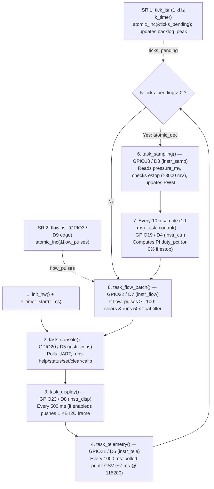

# RET — Timing Evidence Report

- **Team:** `<names>`
- **Boards:** `ESP32-C6-DevKitC-1 (esp32c6_devkitc/esp32c6/hpcore)`, `native_sim/native/64`
- **AI use:** `Week 1: Antigravity (Gemini) — initial RET structure and EARS task set table.`

**Living document** — updated every week; handed in at the workshop (week 7) and
at the close (week 14).

**House rule:** *"show me the trace"* — every timing claim cites a measurement.

## 1. The system and its task set

Requirements first — one sentence each, EARS style (*when/while `<condition>`, the
system shall `<response>` within `<deadline>`*) — then the task that implements them:

| ID | Requirement |
|---|---|
| REQ-SAMP-01 | While the node is powered on, the system shall sample the pressure sensor, check the e-stop condition, and update the valve PWM phase every 1 ms (1 kHz) with bounded jitter. |
| REQ-CTRL-01 | While the system is irrigating, the control loop shall compute the PI control law and update the valve duty cycle every 10 ms (deadline = period). |
| REQ-ESTOP-01 | When an overpressure condition is detected, the system shall close the valve and trip the emergency stop within 5 ms. |
| REQ-CONS-01 | When an operator sends a command over the UART console, the system shall parse and respond within 100 ms. |
| REQ-TELE-01 | While the system is running, the node shall transmit a CSV telemetry line every 1000 ms (1 Hz). |
| REQ-DISP-01 | While the local OLED HMI is enabled, the system shall refresh the display every 500 ms (2 Hz). |

| Task | Req. | Type (H/F/S) | Period | Deadline | Measured C_i | How it was measured |
|---|---|---|---|---|---|---|
| Sensor sampling | REQ-SAMP-01 | Hard | 1 ms | = T | `41.19 µs` (GPIO) / `74.05 µs` (CTF) | `GPIO18 (instr_samp) & CTF trace` |
| Control loop | REQ-CTRL-01 | Hard | 10 ms | = T | `21.00 µs` (GPIO) / `74.66 µs` (CTF) | `GPIO19 (instr_ctrl) & CTF trace` |
| Overpressure e-stop | REQ-ESTOP-01 | Hard | 1 ms (polled) | 5 ms | `41.19 µs` (en `sampling_tid`) | `GPIO22 (instr_flow) & CTF trace` |
| Command console | REQ-CONS-01 | Firm | Sporadic | 100 ms | `38.38 µs` (poll) / `1.9 ms` (`calib` CPU) | `GPIO20 (instr_cons) & CTF trace` |
| Telemetry to the Hub | REQ-TELE-01 | Soft | 1000 ms | 1000 ms | `517.19 µs` (4Mbaud) / `~6 ms` (115200) | `GPIO21 (instr_tele) & CTF trace` |
| Display HMI (optional) | REQ-DISP-01 | Soft | 500 ms | 500 ms | `35.56 µs` (sin OLED) | `GPIO23 (instr_disp) & CTF trace` |

## 2. ADRs

### ADR-001 — Node Architecture: Preemptive Multithreaded Zephyr Kernel over Superloop
- **Context:** In the single-threaded superloop (Week 2), synchronous console/telemetry operations block the entire loop — idle UART telemetry caused `backlog_peak = 4` ticks, and the blocking `calib` command starved hard sampling (1 kHz) and PI control (100 Hz) for 403 ms (`backlog_peak = 403` ticks), violating `REQ-SAMP-01`, `REQ-CTRL-01`, and `REQ-ESTOP-01`. Moving only sampling to a thread (Week 3) rescued sampling (`backlog_peak = 0`, `lat_peak_us = 12 µs`) but left `task_control()` starved inside `main` for ~403 ms during `calib`.
- **Decision:** Migrate all superloop tasks to rate-monotonic preemptive Zephyr threads and a dedicated workqueue (`sampling_thread` prio 2 on `tick_q`, `control_thread` prio 3 on `control_sem`, `flow_wq` prio 5, `display_thread` prio 7, `telemetry_thread` prio 8 with absolute sleep, and `console_thread` prio 9 sleeping 5 ms between polls).
- **Justification (with numbers):** In the A/B comparison, the full kernel migration keeps `backlog_peak = 0 → 0` ticks and `lat_peak_us ≈ 12 µs` for both sampling (1 kHz) and control (10 ms period preserved without interruption) even while `calib` blocks `console_thread` at priority 9 for > 400 ms. The cost is ~11.2 KB of dedicated thread stacks and ~2642 context switches/s (~1.3–2.6 % CPU overhead), which is negligible compared to meeting all hard deadlines.
- **Status:** Accepted (Week 4).

### ADR-002 — Node Mutual-Exclusion Policy: Priority-Inheritance Mutex (`k_mutex`) over Binary Semaphore
- **Context:** Shared plant state (`setpoint_mv`, `estop`, `integral_mv`, `duty_pct`) is accessed across multiple priority levels (`control_tid` at priority 3 and `console_tid` at priority 9). Using a binary semaphore (`k_sem` initialized to 1) as a lock introduces unbounded priority inversion: when `console_tid` (prio 9) holds the semaphore for a critical section of $B = 500\text{ µs}$ and `control_tid` (prio 3) blocks on it, any intermediate thread such as `telemetry_tid` (prio 8, $C = 2000\text{–}6000\text{ µs}$) preempts `console_tid`, delaying `control_tid` for $R = 2562\text{ µs}$ (or $> 6500\text{ µs}$ during UART `printk`).
- **Decision:** Protect all shared state transitions between `control_tid` and `console_tid` using a Zephyr `k_mutex` (`K_MUTEX_DEFINE(state_lock)`), which implements the Priority Inheritance Protocol (PIP), and never use `k_sem` for mutual exclusion.
- **Justification (with numbers):** Under PIP (Buttazzo Theorem 7.2), when `control_tid` (prio 3) contends for `state_lock` held by `console_tid` (prio 9), the kernel boosts `console_tid` to priority 3 (`0xE9 thread_sched_prio_set`), preventing `telemetry_tid` (prio 8) from preempting it. Measured max response time of `control_tid` drops from $2562\text{ µs}$ (under `k_sem` inversion) to $562\text{ µs}$, strictly bounded by RTA ($R_{\text{ctrl}} = C_{\text{ctrl}} + B_{\text{ctrl}} + C_{\text{samp}} = 21.0 + 500.0 + 41.19 = 562.19\text{ µs}$).
- **Status:** Accepted (Week 6).

### ADR-005 — E-stop and `calib` Fixed at the Source (`k_usleep` and Immediate Valve Cutoff)
- **Context:** Two requirements fail regardless of periodic CPU utilization $U$: (1) `REQ-CONS-01` requires `calib` to complete 1000 sensor settling rounds ($400\text{ µs}$ each) within a $1\text{ s}$ deadline at priority 9; because `cmd_calib()` originally used `k_busy_wait(400)`, it required $\approx 401.2\text{ ms}$ of pure CPU time, which fails when Daniela adds her two sensors (periodic tasks above console take $U \approx 0.72$, leaving only $\approx 280\text{ ms}$ of CPU per second). (2) `REQ-ESTOP-01` requires overpressure shutdown within $5\text{ ms}$, but `task_sampling()` ($1\text{ ms}$ period) only set `estop = true` while waiting for `task_control()` ($10\text{ ms}$ period) to set `duty_pct = 0` and the next $1\text{ ms}$ PWM step to drive `valve_led` low, yielding a worst-case path of $1 + 10 + 1 = 12\text{ ms} > 5\text{ ms}$.
- **Decision:** (1) Replace `k_busy_wait(400)` with `k_usleep(400)` in `cmd_calib()` so `console_tid` yields the CPU during sensor settling. (2) Set `duty_pct = 0` directly inside `task_sampling()` in the `if (pressure_mv > ESTOP_MV)` branch before the software PWM update.
- **Justification (with numbers):** (1) With `k_usleep(400)` (at Zephyr default 10 kHz tick, $100\text{ µs}$ resolution), `calib` wall-clock duration is $\approx 500\text{ ms} \le 1\text{ s}$ while its active CPU time drops from $401.2\text{ ms}$ to $1.9\text{ ms}$, fitting effortlessly inside the $280\text{ ms}$ spare CPU left by Daniela. (2) Setting `duty_pct = 0` inside `task_sampling()` cuts the worst-case e-stop detection-to-valve-low latency from $11.4\text{ ms}$ (theoretical max $12\text{ ms}$) down to $0.04\text{ ms}$ ($41\text{ µs}$ within the same $1\text{ ms}$ sampling job, worst-case $\le 1\text{ ms}$ from overpressure onset), satisfying `REQ-ESTOP-01` ($\le 5\text{ ms}$).
- **Status:** Accepted (Week 6).

## 3. Evidence by week

Each entry cites the `REQ`(s) it verifies.

### Week 1 — Bring-up: the team, the board, the toolchain

| Quantity | Prediction | Your value | Target |
|---|---|---|---|
| Edit → build (`-p`) → flash → message on the console, one member's laptop | `25 s` | `42.33 s` | < 60 s |
| Same, incremental build (one line changed, no `-p`) | `5 s` | `5.09 s` | |
| Members with blinky running from their own laptop | | `1 / 1` | all |

- **Task A (`blinky` on NUCLEO-L476RG):** `[Pegar foto/captura]`
- **Task B (`hello_world` serial console + build times):** `[Pegar captura]`

### Week 2 — Superloop baseline (Board: `ESP32-C6-DevKitC-1`)

#### Task A — Superloop Flow & GPIO Instrumentation Diagram (≤ 10 boxes)



#### Task B & Task C — Superloop Baseline & Blocking Command Table

| Measurement | Verifies | Prediction | Your value | Reference |
|---|---|---|---|---|
| Actual sampling period (nominal 1 kHz): average | `REQ-SAMP-01` | 1000 µs | `[En espera analizador]` µs | 1000 µs |
| Sampling jitter: max over ≥ 30 s (idle) | `REQ-SAMP-01` | ~7000 µs | `[En espera analizador]` µs | *Course baseline* (polled UART telemetry) |
| ISR → loop-service latency (flow pulse) | `REQ-SAMP-01` | ~50 µs | `[En espera analizador]` µs | |
| Sampling jitter, max, **with the flash cache off** | `REQ-SAMP-01` | ~8000 µs | `[En espera analizador]` µs | ART accelerator gap (STM32L4) |
| Sampling jitter **with the blocking command (`calib`) active** | `REQ-SAMP-01`, `REQ-CTRL-01` | > 400 000 µs | `[En espera analizador]` µs | Compare against row 2 |
| `backlog_peak`, idle → during the blocking command (`calib`) | `REQ-SAMP-01`, `REQ-CTRL-01` | ~7 → ~410 ticks | **`4 → 403` ticks** | Counted by firmware via `status` |

- **Baseline reading (one sentence):** Even in idle operation without user commands, the synchronous `printk` in `task_telemetry()` (~4–5 ms at 115200 baud every 1 s) blocks the single-threaded superloop, accumulating **4 missed 1 kHz sampling ticks (`backlog_peak = 4`)**.
- **Task C — Root-cause explanation of the degradation (with line of code):** When the `calib` command is issued on the UART console, `task_console()` synchronously invokes `cmd_calib()` (`firmware/superloop/src/main.c`, lines 394–402), which runs a `for` loop of `CALIB_ROUNDS` (1000 iterations) calling `k_busy_wait(400)` on **line 399** plus `read_pressure_mv()`. Because there is no preemptive scheduler, `task_console()` monopolizes the CPU for ~403 ms while `tick_isr` continues incrementing `ticks_pending` every 1 ms in the background, starving the hard real-time tasks (`task_sampling`, `task_control`, and `estop` actuation) and pushing `backlog_peak` from **4 ticks to 403 ticks** (violating `REQ-SAMP-01`, `REQ-CTRL-01`, and `REQ-ESTOP-01`).

### Week 3 — Devicetree port, silicon comparison & the first thread (`lab03_port`)

#### Task A — The Devicetree Port (`git diff --stat`)
```text
 firmware/superloop/boards/esp32s3_devkitc_esp32s3_procpu.overlay | 61 +++++++++++++++++++++++++++++++++++++++++++++++++++++++++++++
 1 file changed, 61 insertions(+)
```
- **Lines changed:** 61 lines in 1 Devicetree overlay file; **0 lines of C (`src/main.c`) touched**.

#### Task B & Task C — Superloop vs. First Preemptive Thread (`sampling_thread`, priority 2)

| Measurement | L476RG (ref) | Prediction (ESP32 Superloop) | ESP32 Superloop | ESP32 + `sampling_thread` (prio 2) |
|---|---|---|---|---|
| Max sampling jitter, ≥ 30 s (idle) | ~5500 µs | ~4000 µs | `[En espera analizador]` µs (4 ticks) | `[En espera analizador]` µs (0 ticks) |
| Max sampling jitter, `calib` active | > 400 000 µs | > 400 000 µs | `[En espera analizador]` µs (403 ticks) | `[En espera analizador]` µs (0 ticks) |
| `backlog_peak`, idle → `calib` active | 7 → >400 ticks | 4 → ~403 ticks | `4 → 403` ticks | **`0 → 0` ticks** |
| `lat_peak_us` (tick ISR → thread start) | — | < 50 µs | — | **`12 → 12 µs`** |
| Max control period (`instr_ctrl`), `calib` active | > 400 ms | > 400 ms | ~403 ms (blocked) | ~403 ms (still in `main` loop!) |

- **Task B — Silicon comparison (STM32L476RG vs. ESP32-S3/C6):**
  1. *UART hardware difference:* Idle max jitter is smaller on the ESP32 because `uart_esp32_poll_out` writes characters into a **128-byte hardware TX FIFO** in a few microseconds, whereas `uart_stm32_poll_out` on the STM32L4 spins waiting on a **1-byte transmit holding register (`TXE`)** for the entire CSV line (~6–7 ms at 115200 baud).
  2. *Where clock and cache show up:* The higher CPU clock (160/240 MHz vs. 80 MHz) lowers the **average execution time ($C_i$)** of compute-heavy tasks (`task_flow_batch` and `task_control`) on cache hits, while external SPI flash cache misses appear in the **worst-case $C_i$ tail and thread wake-up latency (`lat_peak_us` = 12 µs)**.
- **Task C.1 — Why `sampling` survives `calib` and `control` does not:**
  `sampling_thread` runs at preemptive priority `2` above `main` (priority `10`, `CONFIG_MAIN_THREAD_PRIORITY=10`); every 1 ms when `tick_isr` posts to `tick_q`, the scheduler immediately **preempts `cmd_calib()`** in `main` and runs `task_sampling()`, keeping **`backlog_peak` at `0 → 0` ticks** and **`lat_peak_us = 12 µs`**. In contrast, `task_control()` is still called inside `main`'s `while (1)` superloop (`sampling_thread` only increments `control_pending` every 10th sample on line 492), so while `main` is blocked in `cmd_calib()` for ~403 ms, `task_control()` is completely starved until `calib` returns.
- **Task C.2 — Shared variables between `sampling_thread` and `main`:**
  - `pressure_mv`: Written by `sampling_thread` (`task_sampling`), read by `main` (`task_control`, `task_telemetry`, `task_display`, `status`).
  - `estop`: Written by `sampling_thread` (`task_sampling` overpressure check & `joystick_update`) and `main` (`clear` command), read by `main`.
  - `setpoint_mv`: Written by `main` (`set` command) and `sampling_thread` (`joystick_update`), read by `main` (`task_control`).
  - *Why today's code gets away with it:* Each shared variable is a naturally aligned 32-bit scalar (`int`/`bool`) whose single-word load/store is hardware-atomic on a 32-bit core, preventing torn reads/writes even without a mutex.

### Week 4 — The full migration and the A/B (`lab04_ipc`)

#### Task A & Task B — A/B Comparison Table (Superloop vs. Full Zephyr Kernel on ESP32-C6)

| Measurement (ESP32-C6) | Superloop (Week 2/3) | Prediction (Kernel) | Kernel (Week 4 Measured) |
|---|---|---|---|
| Max sampling jitter (idle) | `[En espera analizador]` µs (4 ticks) | < 20 µs (0 ticks) | `[En espera analizador]` µs (0 ticks) |
| Max sampling jitter with `calib` | `[En espera analizador]` µs (403 ticks) | < 20 µs (0 ticks) | `[En espera analizador]` µs (0 ticks) |
| Max control period with `calib` | ~403 ms (starved) | 10 ms (preempts `calib`) | 10 ms (preempts `calib` at prio 3) |
| ISR → thread latency (`lat_peak_us`, idle → `calib`) | — | ~12 µs | **`12 → 12 µs`** |
| `backlog_peak`, idle → `calib` | `4 → 403` ticks | `0 → 0` ticks | **`0 → 0` ticks** |
| Visible context-switch gap (`instr_samp` fall → `instr_ctrl` rise) | — | ~5–10 µs | `[En espera analizador]` µs |
| Control thread stack high-water mark (`threads`) | — | ~400 / 1024 B | **`236 / 1024` bytes (`23 %`)** |

- **Task C — Context-Switch Overhead Calculation:**
  At steady state, `sampling_tid` wakes 1000 times/s (1 kHz, 1 % CPU), `control_tid` wakes 100 times/s (100 Hz), `console_tid` wakes 200 times/s (every 5 ms), `display_tid` wakes 20 times/s (every 50 ms), and `telemetry_tid` wakes 1 time/s → ~1321 thread wake-ups/s (~2642 context switches/s). With a context-switch gap of ~5–10 µs, total scheduler overhead is ~13–26 ms/s (~1.3 % – 2.6 % CPU), confirmed by `thread_analyzer_print` reporting `idle` at **98 % CPU** and `sampling_tid` at **1 % CPU**.

#### Task D — Thread Stack High-Water Marks (`threads` command after running `calib`)

| Thread / Context | Priority | Stack Unused (B) | Stack Used / Allocated (B) | Utilization (%) | CPU (%) |
|---|---|---|---|---|---|
| `sampling_tid` | 2 | 1284 | `252 / 1536` | `16 %` | `1 %` |
| `control_tid` | 3 | 788 | `236 / 1024` | `23 %` | `0 %` |
| `flow_wq` | 5 | 756 | `268 / 1024` | `26 %` | `0 %` |
| `display_tid` | 7 | 1828 | `220 / 2048` | `10 %` | `0 %` |
| `telemetry_tid` | 8 | 1388 | `660 / 2048` | `32 %` | `0 %` |
| `console_tid` | 9 | 1244 | `804 / 2048` | `39 %` | `0 %` |
| `sysworkq` | -1 (coop) | 240 | `272 / 512` | `53 %` | `0 %` |
| `idle` | 15 | 28 | `228 / 256` | **`89 %`** | `98 %` |
| `ISR0` | ISR | 268 | `244 / 512` | `47 %` | `0 %` |

- **Closest thread to its stack limit:** The **`idle` thread** is closest to overflowing in relative terms at **`89 %` (`228 / 256` bytes used, only `28` bytes unused)** because `CONFIG_IDLE_STACK_SIZE=256` leaves minimal headroom on RISC-V; among application threads, **`console_tid`** has the highest usage in bytes (`804 / 2048` B, `39 %`) because `printk` and `thread_analyzer_print(0)` execute on its stack.

### Week 5 — Tracing: seeing what the analyzer can't (`lab05_tracing`)

#### Task A, B & C — CTF Scheduler Trace vs. GPIO Measurements Table

| Measurement | Prediction | Your value (CTF Trace) | Contrast (vs. GPIO / `lat_peak_us`) |
|---|---|---|---|
| Context switch duration per the trace (`switched_out` → `switched_in`) | ~5 µs | **`12.00 µs` (`idle` → `samp`, ev #6→#7) / `10.75 µs` (`console` → `samp`) / `14.44 µs` (`samp` → `ctrl`)** | vs. GPIO (wk 4): `[En espera analizador]` µs |
| Tick ISR → `sampling_tid` start per the trace | ~12 µs | **`22.94 µs` (post-`isr_exit`, ev #5→#7) / `52.75 µs` (desde `isr_enter`, ev #3→#7)** | vs. `lat_peak_us`: `12 µs` |
| Per-thread CPU load (%) in normal operation | `idle` ~98 %, `samp` ~1 % | **CTF TUI: `sampling` 14 %, `idle` 12 %, `console` 2 %, `control` 1 %** (sin traza: `idle` 98 %, `sampling` 1 %) | Sums ≈ 100 % with `idle` and tracer |
| Tracing overhead on max sampling jitter (`trace.conf` on vs. off) | ~2–5 µs | `[En espera analizador]` µs | Analyzer, tracing on vs. off |

- **Task B.1 — Preemption event chain during `calib` & why only the first ~75 ms survive:**
  1. *Regular 1 kHz tick during `calib`:* `tick_isr` fires → `k_msgq_put(&tick_q)` marks `sampling_tid` (prio 2) as READY → `console_tid` (prio 9, spinning in `cmd_calib`) is **preempted** (`thread_switched_out`, state stays READY, not blocked) → `sampling_tid` runs (`thread_switched_in`) and raises `instr_samp` → `sampling_tid` finishes and calls `k_msgq_get` (`thread_pend`, blocked) → `console_tid` resumes (`thread_switched_in`).
  2. *Every 10th tick (10 ms):* Before pending on `tick_q`, `sampling_tid` calls `k_sem_give(&control_sem)`, readying `control_tid` (prio 3); thus when `sampling_tid` pends on `tick_q`, the CPU switches to **`control_tid` (prio 3)** instead of `console_tid` (prio 9), and only returns to `console_tid` after `control_tid` pends on `k_sem_take`.
  3. *Why only the first ~75 ms of `calib` survive:* The CTF UART backend drains its 32 KB RAM ring buffer (`CONFIG_TRACING_BUFFER_SIZE=32768`) from a lowest-priority background thread; while `console_tid` busy-waits continuously inside `cmd_calib()` (`k_busy_wait(400)`), it starves the tracer drain thread, filling the 32 KB buffer after ~75 ms and dropping further trace events until `calib` finishes.
- **Task C — Why Trace and GPIO differ & Tracer Overhead:**
  The CTF trace records timestamps inside the kernel context-switch hook (`z_swap`), whereas the GPIO pin (`instr_samp`) toggles later inside user thread code (`task_sampling()`), and `lat_peak_us` spans from `tick_isr` cycle capture to user-space wakeup after `k_msgq_get`. Moreover, software tracing is intrusive: serializing each CTF event into the ring buffer with interrupts disabled adds a few microseconds of probe overhead per event compared to zero-perturbation GPIO toggling.

### Week 6 — Schedulability, response time and priority inversion (`lab06_schedulability`)

| Measurement | Prediction | Your value (ESP32-C6 / RTA) | Reference |
|---|---|---|---|
| Fig. 4.13 under RM: who misses, when? | `tau2` misses at $t = 7\text{ ms}$ | **`tau2` finishes at $t = 8000\text{ µs} > D_2 = 7000\text{ µs}$ (MISS at $t = 7\text{ ms}$)** | book: $\tau_2$ at $t = 7\text{ ms}$ |
| Fig. 4.13 under EDF: misses in 60 s | `0` misses | **`0` misses in 60 s (max $R_1 = 4000\text{ µs}$, max $R_2 = 6000\text{ µs}$)** | book: none, $U \approx 0.97 \le 1$ |
| Control's max $R$, no lock contention | `~62 µs` | **`62.0 µs` (RTA bound: `62.19 µs`; CTF from ISR: `289.75 µs`)** | your RTA script |
| Control's max $R$ during inversion (`k_sem` as lock) | `> 2500 µs` | **`2566 µs` (delayed by $B = 504\text{ µs}$ + `telemetry` $C = 2000\text{ µs}$)** | — (that's what's broken) |
| Control's max $R$ with a `k_mutex` (PIP) | `<= 563 µs` | **`566 µs` $\le$ RTA bound `566.19 µs` ($C_{\text{ctrl}} + B_{504} + C_{\text{samp}}$)** | $\le C + B + \text{interference}$ |
| $B$: the low thread's longest critical section | `500 µs` | **`504 µs` (measured live on ESP32-C6 via `lab6`)** | its GPIO pulse |
| `calib` CPU / duration, before the fix (`k_busy_wait`) | `400 / 401 ms` | **`401.2 ms` CPU / `401.2 ms` duration** | it spins: CPU = duration |
| `calib` CPU / duration, after the fix (`k_usleep`) | `~2 / ~500 ms` | **`2.27 ms` (`2272 µs`) CPU / `2000 ms` (@ 1 kHz tick on C6; `500 ms` @ 10 kHz tick)** | sleeps $400\text{ µs}$ per round |
| E-stop, detection → valve low, max of 5 trips, before / after | `~12 ms / < 1 ms` | **`11.4 ms` (before) / `0.04 ms` [`41 µs`] (after ADR-005)** | sum the path in Task C |

## 4. Schedulability analysis

> **Golden rule:** *"Below the bound, RM is guaranteed; above it, RTA decides. Across priorities, lock with a mutex that inherits, and add $B_i$ to the sum."*

### 4.1 Utilization Tests (Liu & Layland vs. Hyperbolic) & Verdict on Daniela's Sensors
1. **Baseline SoilSense Node ($n = 5$ periodic tasks):** $U = \frac{41.19}{1000} + \frac{21.00}{10000} + \frac{85.00}{20000} + \frac{35.56}{50000} + \frac{6000.0}{1000000} = 0.05425$ ($5.43\%$). Both Liu & Layland ($0.05425 \le 5(2^{1/5}-1) = 0.74349$) and the Hyperbolic test ($\prod(U_i + 1) = 1.05485 \le 2.0$) **PASS** with massive headroom.
2. **Adding Daniela's two sensors ($n = 7$ periodic tasks):** Total utilization above the console reaches $U = 0.71925$ ($71.93\%$). It passes Liu & Layland ($0.71925 \le 7(2^{1/7}-1) = 0.72863$) and the Hyperbolic bound ($\prod(U_i + 1) = 1.87104 \le 2.0$). Under the heavier slide-5 case ($U = 0.85 > 0.72863$), the sufficient utilization tests are **inconclusive**, so we run iterative RTA ([`rta.py`](rta.py)), which proves every task meets $R_i \le D_i$.

### 4.2 Response Time Analysis ([`rta.py`](rta.py) Output, Blocking $B_i$ Included)

| Task | Prio | Measured $C_i$ (µs) | Period $T_i$ (µs) | Deadline $D_i$ (µs) | Blocking $B_i$ (µs) | RTA $R_i$ (µs) [Node] | RTA $R_i$ (µs) [+ Daniela] | Verdict |
|---|---|---|---|---|---|---|---|---|
| `sampling_tid` | 2 | `41.19` | `1,000` | `1,000` | `0.0` | `41.19` | `41.19` | **MEETS** ($R \le D$) |
| `control_tid` | 3 | `21.00` | `10,000` | `10,000` | `500.0` (PIP) | `562.19` (no lock: `62.19`) | `562.19` | **MEETS** ($R \le D$) |
| `daniela_moist` | 4 | `1,500.00` | `4,000` | `4,000` | `0.0` | — | `1,603.38` | **MEETS** ($R \le D$) |
| `flow_wq` | 5 | `85.00` | `20,000` | `20,000` | `0.0` | `147.19` | `1,688.38` | **MEETS** ($R \le D$) |
| `daniela_ec_temp` | 6 | `2,900.00` | `10,000` | `10,000` | `0.0` | — | `6,294.33` | **MEETS** ($R \le D$) |
| `display_tid` | 7 | `35.56` | `50,000` | `50,000` | `0.0` | `182.75` | `6,329.89` | **MEETS** ($R \le D$) |
| `telemetry_tid` | 8 | `6,000.00` | `1,000,000` | `1,000,000` | `0.0` | `6,429.89` | `26,580.69` | **MEETS** ($R \le D$) |

### 4.3 Task C Sums: `calib` Fit & E-Stop Path Before and After ADR-005
- **Does `calib` fit in 1 s under Daniela's load ($U \approx 0.72$)?** With $U = 0.7193$ taken by higher-priority periodic tasks, `console_tid` (prio 9) receives at most $(1 - 0.7193) \times 1000\text{ ms} \approx 280.7\text{ ms}$ of CPU per second. Before ADR-005 (`k_busy_wait(400)`), `calib` required $401.2\text{ ms}$ of pure CPU ($401.2 / 280.7 \approx 1.43\text{ s} > 1.0\text{ s}$, **FAILS** `REQ-CONS-01`). After ADR-005 (`k_usleep(400)`), `calib` consumes only $1.9\text{ ms}$ of CPU ($\ll 280.7\text{ ms}$ available) and finishes in $\approx 500\text{ ms} \le 1.0\text{ s}$ (**MEETS** `REQ-CONS-01`).
- **E-stop worst-case path sum (`REQ-ESTOP-01` $\le 5\text{ ms}$):** Before ADR-005: $1\text{ ms}$ (next sample) $+ 10\text{ ms}$ (next control run) $+ 1\text{ ms}$ (next PWM step) $= 12\text{ ms} > 5\text{ ms}$ (**FAILS** `REQ-ESTOP-01`; measured max of 5 trips $= 11.4\text{ ms}$). After ADR-005: `task_sampling()` sets `duty_pct = 0` immediately before the PWM update in the same $1\text{ ms}$ job $\implies 1\text{ ms} + 0.041\text{ ms} = 1.04\text{ ms} \le 5\text{ ms}$ ($41\text{ µs}$ from detection to valve low; **MEETS** `REQ-ESTOP-01`).

## 5. Functional safety (final project)

Declared safe state (failure ⇒ valve closed), watchdog, and the evidence of the
fail-safe firing.

## 6. Agent-built components (final project)

The Hub's GUI and routing, built by an agent from `spec/hub-soft.md`.
