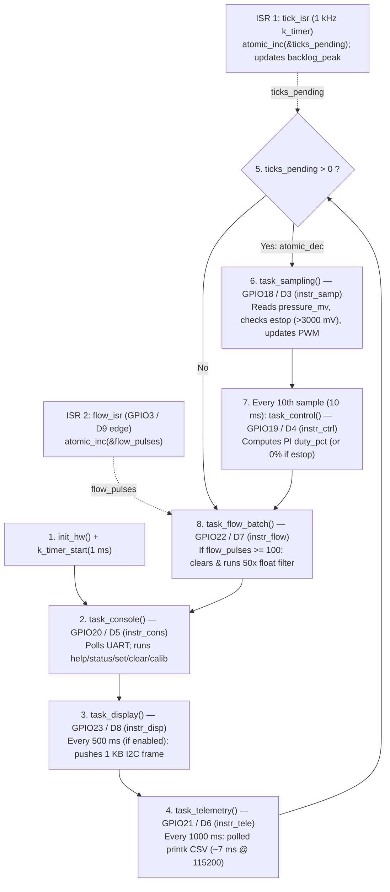

# RET — Timing Evidence Report

- **Team:** `<names>`
- **Boards:** `ESP32-C6-DevKitC-1 (esp32c6_devkitc/esp32c6/hpcore)`, `native_sim/native/64`
- **AI use:** `Week 1: Antigravity (Gemini) — initial RET structure and EARS task set table.`

**Living document** — updated every week; handed in at the workshop (week 7) and
at the close (week 14).

**House rule:** *"show me the trace"* — every timing claim cites a measurement.

## 1. The system and its task set

Requirements first — one sentence each, EARS style (*when/while `<condition>`, the
system shall `<response>` within `<deadline>`*) — then the task that implements them:

| ID | Requirement |
|---|---|
| REQ-SAMP-01 | While the node is powered on, the system shall sample the pressure sensor, check the e-stop condition, and update the valve PWM phase every 1 ms (1 kHz) with bounded jitter. |
| REQ-CTRL-01 | While the system is irrigating, the control loop shall compute the PI control law and update the valve duty cycle every 10 ms (deadline = period). |
| REQ-ESTOP-01 | When an overpressure condition is detected, the system shall close the valve and trip the emergency stop within 5 ms. |
| REQ-CONS-01 | When an operator sends a command over the UART console, the system shall parse and respond within 100 ms. |
| REQ-TELE-01 | While the system is running, the node shall transmit a CSV telemetry line every 1000 ms (1 Hz). |
| REQ-DISP-01 | While the local OLED HMI is enabled, the system shall refresh the display every 500 ms (2 Hz). |

| Task | Req. | Type (H/F/S) | Period | Deadline | Measured C_i | How it was measured |
|---|---|---|---|---|---|---|
| Sensor sampling | REQ-SAMP-01 | Hard | 1 ms | = T | ____ | `<GPIO + analyzer / trace>` |
| Control loop | REQ-CTRL-01 | Hard | 10 ms | = T | ____ | `<GPIO + analyzer / trace>` |
| Overpressure e-stop | REQ-ESTOP-01 | Hard | 1 ms (polled) | 5 ms | ____ | `<GPIO + analyzer / trace>` |
| Command console | REQ-CONS-01 | Firm | Sporadic | 100 ms | ____ | `<GPIO + analyzer / trace>` |
| Telemetry to the Hub | REQ-TELE-01 | Soft | 1000 ms | 1000 ms | ____ | `<GPIO + analyzer / trace>` |
| Display HMI (optional) | REQ-DISP-01 | Soft | 500 ms | 500 ms | ____ | `<GPIO + analyzer / trace>` |

## 2. ADRs

### ADR-001 — `<title>`
**Context:** … · **Decision:** … · **Justification (with numbers):** … · **Status:** …

## 3. Evidence by week

Each entry cites the `REQ`(s) it verifies.

### Week 1 — Bring-up: the team, the board, the toolchain

| Quantity | Prediction | Your value | Target |
|---|---|---|---|
| Edit → build (`-p`) → flash → message on the console, one member's laptop | ____ s | ____ s | < 60 s |
| Same, incremental build (one line changed, no `-p`) | ____ s | ____ s | |
| Members with blinky running from their own laptop | | ____ / ____ | all |

- **Task A (`blinky` on NUCLEO-L476RG):** `[Pegar foto/captura]`
- **Task B (`hello_world` serial console + build times):** `[Pegar captura]`

### Week 2 — Superloop baseline (Board: `ESP32-C6-DevKitC-1`)

#### Task A — Superloop Flow & GPIO Instrumentation Diagram (≤ 10 boxes)

#### Task B & Task C — Superloop Baseline & Blocking Command Table

| Measurement | Verifies | Prediction | Your value | Reference |
|---|---|---|---|---|
| Actual sampling period (nominal 1 kHz): average | `REQ-SAMP-01` | 1000 µs | `[En espera analizador]` µs | 1000 µs |
| Sampling jitter: max over ≥ 30 s (idle) | `REQ-SAMP-01` | ~7000 µs | `[En espera analizador]` µs | *Course baseline* (polled UART telemetry) |
| ISR → loop-service latency (flow pulse) | `REQ-SAMP-01` | ~50 µs | `[En espera analizador]` µs | |
| Sampling jitter, max, **with the flash cache off** | `REQ-SAMP-01` | ~8000 µs | `[En espera analizador]` µs | ART accelerator gap (STM32L4) |
| Sampling jitter **with the blocking command (`calib`) active** | `REQ-SAMP-01`, `REQ-CTRL-01` | > 400 000 µs | `[En espera analizador]` µs | Compare against row 2 |
| `backlog_peak`, idle → during the blocking command (`calib`) | `REQ-SAMP-01`, `REQ-CTRL-01` | ~7 → ~410 ticks | **`4 → 403` ticks** | Counted by firmware via `status` |

- **Baseline reading (one sentence):** Even in idle operation without user commands, the synchronous `printk` in `task_telemetry()` (~4–5 ms at 115200 baud every 1 s) blocks the single-threaded superloop, accumulating **4 missed 1 kHz sampling ticks (`backlog_peak = 4`)**.
- **Task C — Root-cause explanation of the degradation (with line of code):** When the `calib` command is issued on the UART console, `task_console()` synchronously invokes `cmd_calib()` (`firmware/superloop/src/main.c`, lines 394–402), which runs a `for` loop of `CALIB_ROUNDS` (1000 iterations) calling `k_busy_wait(400)` on **line 399** plus `read_pressure_mv()`. Because there is no preemptive scheduler, `task_console()` monopolizes the CPU for ~403 ms while `tick_isr` continues incrementing `ticks_pending` every 1 ms in the background, starving the hard real-time tasks (`task_sampling`, `task_control`, and `estop` actuation) and pushing `backlog_peak` from **4 ticks to 403 ticks** (violating `REQ-SAMP-01`, `REQ-CTRL-01`, and `REQ-ESTOP-01`).

## 4. Schedulability analysis

U = ΣC_i/T_i with **measured** C_i; test used (RM / hyperbolic / EDF); RTA as a
script with its output; blocking B_i if there are mutexes.

## 5. Functional safety (final project)

Declared safe state (failure ⇒ valve closed), watchdog, and the evidence of the
fail-safe firing.

## 6. Agent-built components (final project)

The Hub's GUI and routing, built by an agent from `spec/hub-soft.md`.
